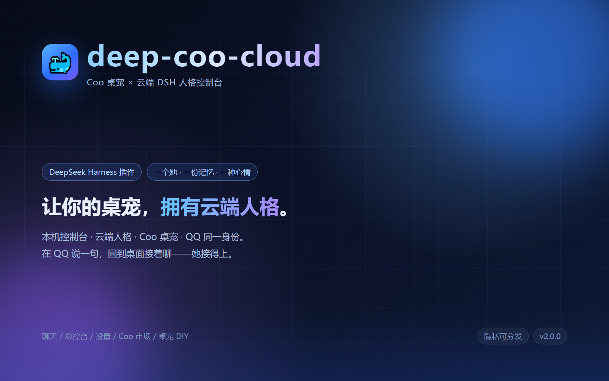
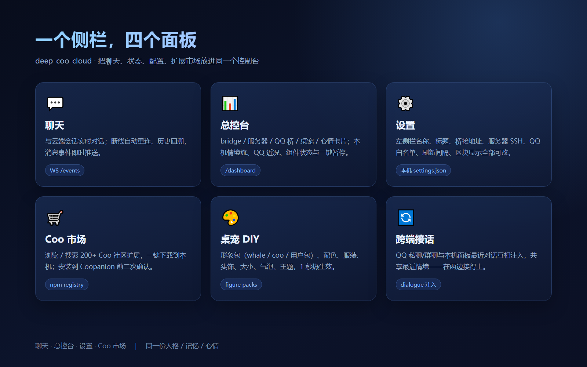
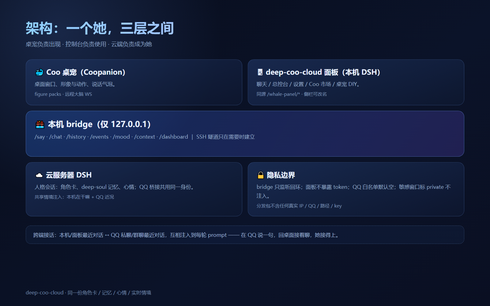
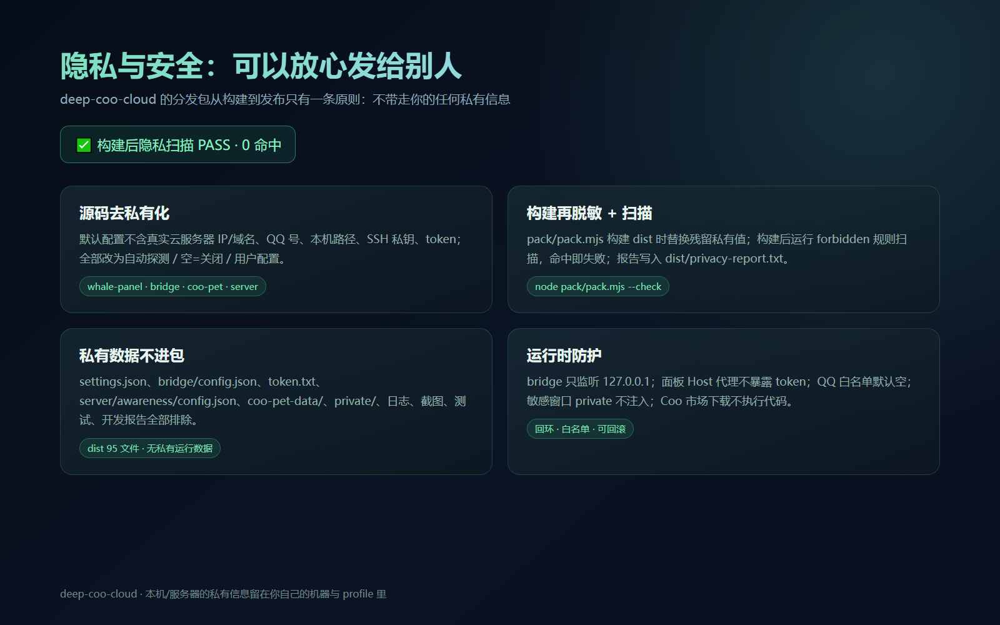
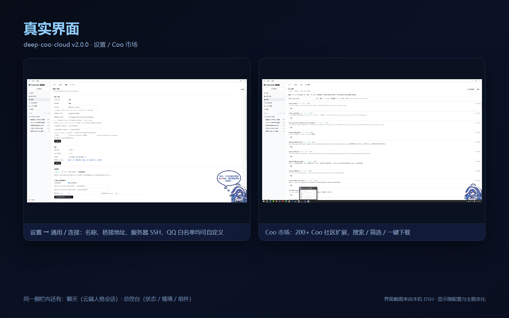

# deep-coo-cloud

> **Coo 桌宠 × 云端 DSH 人格控制台** —— 一个侧栏，四个面板；一个她，一份记忆，一种心情。

## 这是什么

**deep-coo-cloud** 是一个 [DeepSeek Harness](https://github.com/deepseek-ai)（DSH）插件，把「桌面上的 Coo 桌宠」「本机 DSH 控制台」「云服务器上的 DSH 人格」串成同一个她：

- 桌宠（Coopanion）负责**被看见、被触摸、说话**
- 本机 DSH Web UI 里的 **deep-coo-cloud 面板** 负责**聊天 / 总控台 / 设置 / Coo 市场 / 桌宠 DIY**
- 云服务器上的 DSH 会话负责**人格、角色卡、记忆、心情**，并通过 QQ 桥接与 QQ 里的她共用同一份人格

所有入口共享同一份角色卡、同一份 deep-soul 记忆、同一份实时情境，因此你可以在 QQ 上说一句、回到本机面板接着聊——她接得上。

## 核心特性

- **一个侧栏，四个面板**：聊天 / 总控台 / 设置 / Coo 市场（侧栏名称、面板标题可自定义）
- **人格同调**：同一角色卡、同一记忆/心情、同一实时情境，注入所有鲸歌会话
- **跨端接话**：本机/面板最近对话 ↔ QQ 私聊/群聊最近对话互相注入
- **桌宠 DIY**：形象包（whale / coo / 用户包 + **ZIP 导入**）、配色、服装、头饰、大小、气泡、主题，~1 秒热生效
- **总控台「本机桌宠插件」**：前台感知/游戏陪玩、跨端接话、桌宠 DIY 状态；保留远程人格与 QQ 同一身份
- **换装页快捷栏**：`/dress` 地板 6 个图标可点（主程序 / 形象包目录 / 官网 / 邮箱 / 音效 / DSH 面板）
- **Coo 市场**：浏览 / 搜索 200+ Coo 社区 Cortico 扩展，一键下载（安装到 Coopanion 需二次确认）
- **隐私可分发**：源码去私有化 + 构建脱敏 + 构建后隐私扫描（0 命中才通过）

## 组件

| 目录 | 说明 | 必需 |
| --- | --- | --- |
| `deep-coo-cloud/` | DSH 面板插件（聊天 / 总控台 / 设置 / Coo 市场 / 桌宠 DIY） | ✅ |
| `bridge/` | 本机桥接服务（连你的 DSH 服务器） | 用云端人格时必需 |
| `dsh-coo-pet-remote/` | Coo 桌宠插件（可选） | 可选 |
| `context-observer/` | 本机情境观察器（可选） | 可选 |
| `server/` | 服务器侧共享情境注入（可选） | 可选 |
| `docs/` | 介绍文档与配图 | — |

## 快速开始

1. `plugin_manager install_bundle link:<路径>/deep-coo-cloud` → 刷新 DSH 页面
2. 复制 `bridge/config.example.json` → `config.json`，填自己的服务器 / SSH / 角色卡 → `node bridge/server.mjs`
3. 面板「设置 → 通用/连接」填左侧栏名称、桥接地址、服务器 SSH、QQ 白名单（只存本机）
4. 详细安装：见 [INSTALL.md](INSTALL.md)

## 隐私设计

- 本仓库**不含**任何真实服务器 IP/域名、QQ 号、本机用户路径、SSH 私钥或 token
- 运行时私有数据（`settings.json`、`bridge/config.json`、`token.txt`、`server/awareness/config.json`、`coo-pet-data/`）不进入仓库
- 打包构建后自动扫描，`privacy-report.txt` 必须 PASS
- bridge 只监听 `127.0.0.1`；QQ 预览白名单默认空；敏感窗口可标记 private 不注入

## 真实界面

## 文档

- [插件介绍（完整）](docs/deep-coo-cloud-intro.md)
- [安装说明](INSTALL.md)

## 致谢 / 第三方

- 上游桌宠插件：`dsh-coo-pet`（MIT）— <https://github.com/vortioxetine213/dsh-coo-pet>
- Coopanion / Cortico：本仓库**不重新分发**其源码或美术素材；插件在运行期从用户已安装的 Coopanion 读取页面素材与形象包，版权归原作者所有（AGPL-3.0 / 第三方声明见 Coopanion 项目）
- DeepSeek Harness：插件框架与 API 归其作者所有

## License

本仓库中由 deep-coo-cloud 项目编写的代码以 **MIT** 许可发布；见 [LICENSE](LICENSE) 与 [NOTICE](NOTICE)。
第三方组件/素材遵循其各自许可证，不在本仓库重新分发。
